# Report on lab3

## Завдання на лабораторну роботу.

### 1) Проаналізувати структуру файлу /etc/passwd та /etc/group, які поля в ній присутні, які користувачі в системі існують? Вкажіть кілька псевдокористувачів, як їх визначити?

Для аналізу структури облікових записів у системі я переглянув вміст файлу /etc/passwd за допомогою команди cat.

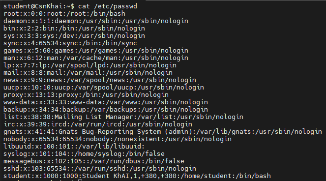

Кожен рядок файлу відповідає одному користувачу і містить поля, розділені двокрапкою (:): ім'я користувача, пароль (x), ідентифікатор користувача (UID), ідентифікатор групи (GID), повне ім'я або опис, домашній каталог та командну оболонку (shell).

У результаті виведені системні псевдокористувачі такі як root, daemon, bin, sys, nobody... 

```
root:x:0:0:root:/root:/bin/bash
daemon:x:1:1:daemon:/usr/sbin:/usr/sbin/nologin
bin:x:2:2:bin:/bin:/usr/sbin/nologin
sys:x:3:3:sys:/dev:/usr/sbin/nologin
sync:x:4:65534:sync:/bin:/bin/sync
games:x:5:60:games:/usr/games:/usr/sbin/nologin
man:x:6:12:man:/var/cache/man:/usr/sbin/nologin
lp:x:7:7:lp:/var/spool/lpd:/usr/sbin/nologin
mail:x:8:8:mail:/var/mail:/usr/sbin/nologin
news:x:9:9:news:/var/spool/news:/usr/sbin/nologin
uucp:x:10:10:uucp:/var/spool/uucp:/usr/sbin/nologin
proxy:x:13:13:proxy:/bin:/usr/sbin/nologin
www-data:x:33:33:www-data:/var/www:/usr/sbin/nologin
backup:x:34:34:backup:/var/backups:/usr/sbin/nologin
list:x:38:38:Mailing List Manager:/var/list:/usr/sbin/nologin
irc:x:39:39:ircd:/var/run/ircd:/usr/sbin/nologin
gnats:x:41:41:Gnats Bug-Reporting System (admin):/var/lib/gnats:/usr/sbin/nologin
nobody:x:65534:65534:nobody:/nonexistent:/usr/sbin/nologin
libuuid:x:100:101::/var/lib/libuuid:
syslog:x:101:104::/home/syslog:/bin/false
messagebus:x:102:105::/var/run/dbus:/bin/false
sshd:x:103:65534::/var/run/sshd:/usr/sbin/nologin
```

А також присутній звичайний користувач системи (student) з відповідним UID:

```
student:x:1000:1000:Student KhAI,1,+380,+380:/home/student:/bin/bash
```

Псевдокористувачі необхідні для запуску фонових служб. Як правило, вони мають спеціальні низькі ідентифікатори (UID) та не призначені для інтерактивного входу в систему (мають оболонку типу /usr/sbin/nologin або /bin/false)

Для перегляду інформації про системні групи я також звернувся до файлу /etc/group.

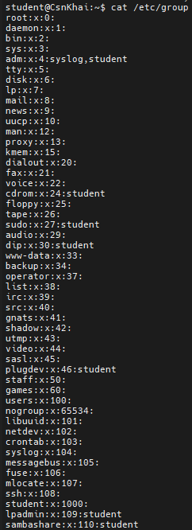

Цей файл визначає системні групи. Його структура складається з полів: назва_групи:пароль:GID:список_користувачів_у_групі. Кожна група об'єднує користувачів для спільного доступу до ресурсів та управління правами.

---

### 2) Які існують негласні діапазони UID? Що таке UID? Як його визначити?

Для визначення ідентифікатора поточного користувача (UID) та його приналежності до груп (GID) я використав утиліту id

```
student@CsnKhai:~$ id
uid=1000(student) gid=1000(student) groups=1000(student),4(adm),24(cdrom),27(sudo),30(dip),46(plugdev),109(lpadmin),110(sambashare)
```

UID (User Identifier) — це унікальне ціле число, яке Linux використовує для внутрішньої ідентифікації кожного користувача. Незалежно від текстового імені облікового запису, система розрізняє користувачів саме за їх числовим UID.

За загальноприйнятими стандартами в Ubuntu виділяють такі негласні діапазони:

0 — зарезервовано виключно для суперкористувача (root).
від 1 до 999 — зарезервовані системні UID для псевдокористувачів і фонових служб.
від 1000 і вище — діапазон, що призначається для звичайних користувачів системи.

---

### 3) Що таке GID? Як його визначити?

Ідентифікатор групи (GID) поточного користувача також було визначено за допомогою команди id.

```
student@CsnKhai:~$ id
uid=1000(student) gid=1000(student) groups=1000(student),4(adm),24(cdrom),27(sudo),30(dip),46(plugdev),109(lpadmin),110(sambashare)
```

GID (Group Identifier) — це числовий ідентифікатор групи в Linux. Кожному користувачеві при створенні призначається основна група, а також він може належати до кількох додаткових груп. Це необхідно для розмежування прав доступу до файлів і ресурсів.

У виводі команди id параметр gid=1000(student) вказує на числовий ідентифікатор основної групи. Також значення GID можна переглянути в четвертому полі файлу /etc/passwd або у файлі /etc/group

---

### 4) Як визначити, хто входить до якої групи?

За допомогою команди id можна побачити список усіх груп, у яких складається поточний користувач:

```
student@CsnKhai:~$ id
uid=1000(student) gid=1000(student) groups=1000(student),4(adm),24(cdrom),27(sudo),30(dip),46(plugdev),109(lpadmin),110(sambashare)
```

У виводі параметр groups= виводить список усіх додаткових та основних груп, до яких входить користувач наприклад: adm, cdrom, sudo, dip, plugdev...

---

### 5) Які існують команди для додавання користувача до системи? Які основні параметри необхідні для створення користувача?

Для додавання нового користувача до системи використовується утиліта useradd. Спочатку я створив обліковий запис user1:

```
student@CsnKhai:/$ sudo useradd -m -s /bin/bash user1
```

Оскільки при створенні через useradd пароль не задається за замовчуванням, я встановив пароль за допомогою спеціальної утиліти passwd:

```
student@CsnKhai:/$ sudo passwd user1
Enter new UNIX password:
Retype new UNIX password:
passwd: password updated successfully
```

У файлі конфігурації /etc/passwd з'явився новий коректний запис із наступним вільним ідентифікатором (UID: 1001):

```
student:x:1000:1000:Student KhAI,1,+380,+380:/home/student:/bin/bash
user1:x:1001:1001::/home/user1:/bin/bash
```

Після цього я переключився на створений акаунт і перевірив робочу директорію за допомогою команди pwd, яка підтвердила правильність створення домашнього каталогу:

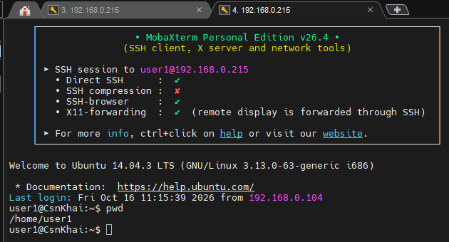

---

### 6) Як змінити ім'я (ім'я облікового запису) існуючого користувача?

Я змінив ім'я створеного раніше користувача user1 на нове ім'я user1_mod:

```
student@CsnKhai:/$ sudo usermod -l user1_mod user1
```

Після виконання команди я перевірив файл конфігурації за допомогою cat /etc/passwd, де переконався що логін успішно оновився на user1_mod:

```
student:x:1000:1000:Student KhAI,1,+380,+380:/home/student:/bin/bash
user1_mod:x:1001:1001::/home/user1:/bin/bash
```

Потім я зайшов у систему під новим обліковим записом і перевірив шлях до поточної робочої директорії за допомогою команди pwd:

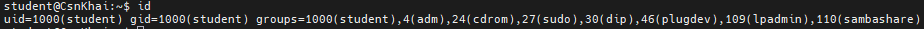

Тому що команда яку я використав тільки змінює логін користувача не чіпаючи домашній каталог. 

---

### 7) Що таке skell_dir? Яка його структура?

Спочатку я переглянув вміст каталогу /etc/skel за допомогою команди ls -la:

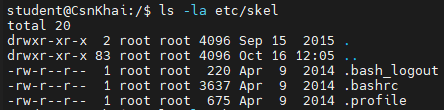

Skeleton directory — це системна директорія в Linux, яка використовується як шаблон за замовчуванням під час створення нових користувачів. Коли ми створюємо нового користувача операційна система автоматично копіює весь вміст із каталогу /etc/skel у новостворену домашню директорію користувача.

У виводі команди містяться приховані файли конфігурації оболонки за замовчуванням:

```
.bash_logout — виконується при виході користувача з командної оболонки.
.bashrc — скрипт конфігурації для налаштування середовища інтерактивної оболонки Bash.
.profile — файл конфігурації, який виконується при вході користувача в систему.
```

Вивід /etc/skel і вміст домашньої папки щойно створеного користувача user1 повністю ідентичний. Це забезпечує те, що кожен новий користувач одразу отримує стандартний і готовий до роботи набір базових конфігурацій без необхідності налаштовувати їх вручну.

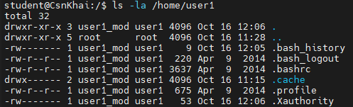

---

### 8) Як видалити користувача із системи (включаючи його поштову скриньку)?

Для початку я створив нового користувача якого буду видаляти user2 также як створював в 5 завданні:

```
student@CsnKhai:/$ sudo useradd -m -s /bin/bash user2
student@CsnKhai:/$ sudo passwd user2
Enter new UNIX password:
Retype new UNIX password:
passwd: password updated successfully
```

Після цього перевірив його створення у файлу passwd

```
student:x:1000:1000:Student KhAI,1,+380,+380:/home/student:/bin/bash
user2:x:1002:1002::/home/user2:/bin/bash
user1_mod:x:1001:1001::/home/user1:/bin/bash
```

Перед видаленням користувача user2 я перевірив системний каталог поштових повідомлень /var/mail, де зберігаються поштові скриньки (spool) користувачів:

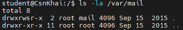

Оскільки для цього користувача поштова скринька не створювалася автоматично, у каталозі не було файлу з ім'ям user2.
Після цього я виконав команду для видалення користувача user2 разом із його домашньою директорією та файлами:

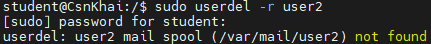

Тепер у файлі директорії etc/passwd знаходяться тільки записи student та user1_mod

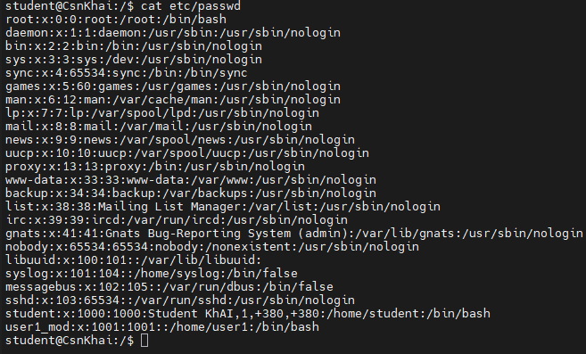

---

### 9) Які потрібно використовувати команди та ключі для блокування та розблокування облікового запису користувача?

Щоб заблокувати користувача user1_mod, я виконав команду з ключем -L:

```
student@CsnKhai:/$ sudo usermod -L user1_mod
[sudo] password for student:
```

Ця команда додає знак оклику ! на початку зашифрованого рядка пароля у системному файлі конфігурації /etc/shadow. Через це спроба увійти в систему під цим обліковим записом стає неможливою, оскільки перевірка автентичності відхиляється парольною системою.

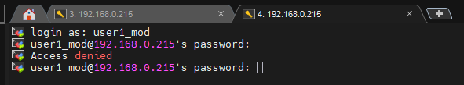

Після перевірки блокування я повернув користувачеві можливість входу до системи, розблокувавши його за допомогою ключа -U:

```
student@CsnKhai:/$ sudo usermod -U user1_mod
```

Команда видаляє знак оклику з файлу /etc/shadow, відновлюючи початковий хеш пароля, після чого успішно вдається знову увійти під цим профілем.

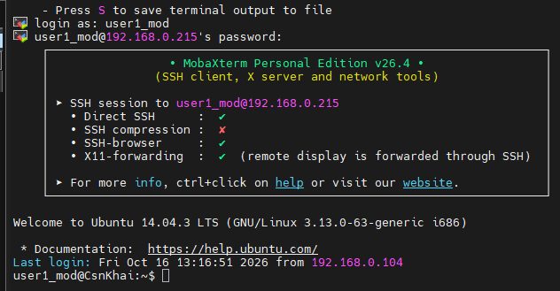

---

### 10) Як зняти пароль користувача та надати йому безпарольний вхід для подальшої зміни пароля?

Я виконав команду для скидання терміну дії пароля користувача user1_mod:

```
student@CsnKhai:/$ sudo passwd -e user1_mod
passwd: password expiry information changed.
```

Система змінила параметри терміну дії пароля у файлі /etc/shadow, встановивши час його останньої зміни таким чином, що він автоматично вважається простроченим.

Після цього я здійснив спробу входу під обліковим записом user1_mod. Система одразу заблокувала стандартну сесію та видала попередження про те, що пароль прострочено, вимагаючи його негайної зміни. 

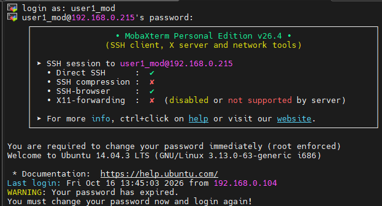

Для продовження входу система попросила ввести поточний (старий) пароль, а потім двічі ввести новий пароль:

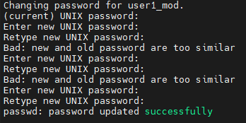

Після успішного введення нового пароля система зберегла його, скинула статус прострочення та надала користувачеві повноцінний доступ до командної оболонки

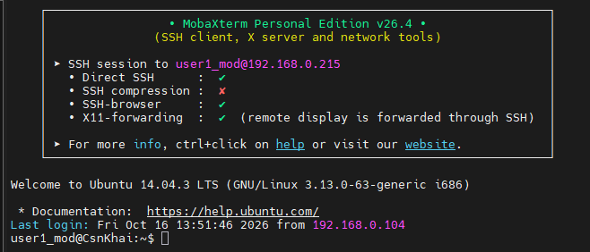

---

### 11) Вивести розширений формат інформації про каталог, розповісти про інформаційні стовпці, що виводяться на термінал.


Для виведення розширеної інформації про файли та каталоги я виконав команду ls із прапорцем -l у домашньому каталозі:

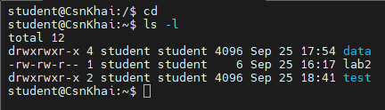

Кожний рядок результату команди ls -l детально описує об'єкт і складається з 9 наступних стовпців:

- Перший стовпчик: Складається з 10 символів. Перший символ вказує на тип файлу. Наступні 9 символів задають права доступу для власника, групи та інших користувачів.
- Другий стовпчик: Вказує кількість жорстких посилань на файл або кількість вкладених елементів.
- Третій стовпчик: Ім'я користувача, якому належить файл чи каталог.
- Четвертий стовпчик: Назва системної групи, за якою закріплений об'єкт.
- П'ятий стовпчик: Розмір файлу або каталогу у байтах.
- Шостий, сьомий та восьмий стовпчики: Точна дата та час останньої модифікації файлу.
- Дев'ятий стовпчик: Власне назва файлу або каталогу.

---

### 12) Які права доступу існують і для когось (тобто описати основні ролі)? Опишіть коротко абревіатуру прав доступу.

Для демонстрації категорій користувачів та прав доступу я використав попередній вивід розширеного формату команди ls -l у домашньому каталозі:


В Linux права доступу до будь-якого файлу чи каталогу розділені на три незалежні категорії:

- Власник (u — User): конкретний користувач, який створив файл або є його власником.
- Група (g — Group): системна група користувачів, яким надано спільні права до цього об'єкта.
- Інші (o — Others): усі інші користувачі системи, які не є власником файлу і не входять до його групи.

Абревіатура прав доступу:
Кожна з цих ролей управляється трьома основними типами прав, які у виводі позначаються літерними символами:

- r (Read): дозволя є переглядати вміст файлу або виводити список файлів у каталозі.
- w (Write): дозволяє змінювати, редагувати чи видаляти файл, а також створювати чи видаляти файли всередині каталогу.
- x (Execute): дозволяє запускати файл як програму або скрипт, а для каталогів — здійснювати перехід в них.

Якщо замість літери у праві стоїть дефіс (-), це означає, що відповідна дія заборонена. Наприклад, для файлу lab2 права доступу -rw-rw-r-- означають, що власник і група можуть читати й редагувати файл, а інші користувачі мають право лише читати його.

---

### 13) Яка послідовність визначення відносин між файлом та користувачем?

Коли користувач намагається звернутися до певного файлу чи каталогу в Linux, ядро послідовно перевіряє його права доступу за чітко визначеним алгоритмом. Ця послідовність визначає, які саме права будуть застосовані.

Хід та етапи перевірки прав доступу:

Перевірка на суперкористувача (root):
- Перш за все система перевіряє, чи є користувач, який виконує запит, суперкористувачем.
- Якщо це root, йому надається повний доступ до читання, запису чи виконання практично будь-якого файлу системи, і подальші перевірки ролей і прав ігноруються.   

Перевірка прав власника (User):
- Якщо запит виконує звичайний користувач, система спочатку перевіряє, чи є цей користувач безпосереднім власником даного файлу.
- Для цього порівняюється UID поточного користувача з UID власника файлу. Якщо збіг є, застосовуються виключно права доступу, прописані для власника, а перевірка інших ролей зупиняється.

Перевірка прав групи (Group):
- Якщо користувач не є власником файлу, система перевіряє, чи належить він до групи, за якою закріплений цей файл.
- Якщо GID користувача збігаєтсья з GID файлу, застосовуються права доступу, встановлені для групи.

Застосування прав для інших (Others):
- Якщо користувач не є ні власником файлу, ні членом його групи, до нього автоматично застосовуються загальні права для інших. Якщо в цій категорії права відсутні (---), доступ до файлу повністю забороняється.

---

### 14) Які команди використовуються для зміни власника файлу (каталогу) та режиму доступу до файлу? Наведіть приклади, продемонструйте на терміналі.

Спочатку я ввів команду ls -l щоб подивитись на початкові права доступу для файлу lab2

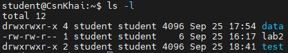

Початкові права: -rw-rw-r-- означають, що власник (student) і члени групи (student) мають права на читання та запис (rw-), а всі інші користувачі системи мають право лише на читання (r--).

Потім я змінив права доступу до цього файлу за допомогою символьного методу, додавши право на виконання (+x) для власника та групи:

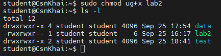

- У команді ug+x літери позначають ролі: u (user), g (group).
- Знак + означає додавання права.
- Літера x означає право на виконання.

У результаті до прав власника та групи додалося виконання, а рядок прав змінився з -rw-rw-r-- на -rwxrwxr--.

Також за допомогою прав суперкористувача я змінив власника файлу lab2, передавши його іншому обліковому запису user1_mod:

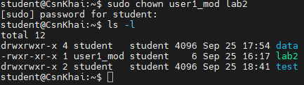

У третьому стовпчику виводу тепер замість student відображається новий власник user1_mod, тоді як група student залишилася незмінною.

---

### 15) Наведіть приклад восьмеричного надання прав доступу. Опишіть umask.

Спочатку я змінив права доступу до файлу lab2, встановивши нове восьмеричне значення 755 за допомогою команди chmod:

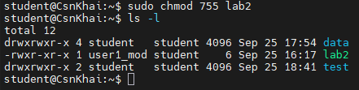

Вираз 755 у восьмеричній системі задає такий розподіл:

- 7 (для власника) = rwx читання, запис і виконання.
- 5 (для групи) = r-x читання та виконання, без права запису.
- 5 (для інших) = r-x читання та виконання.

У результаті рядок прав змінився з -rwxrwxr-- на -rwxr-xr-x.

umask — це маска за замовчуванням, яка регулює права доступу під час створення нових файлів і каталогів. Вона задається у вигляді восьмеричного числа і визначає атрибути, які не потрібно встановлювати новому файлу чи каталогу.   

Перевірка поточної маски в системі за допомогою команди umask:

```
student@CsnKhai:~$ umask
0002
```

Якщо встановлено umask 0002, то з базових прав повністю прибираються обмеження на запис для групи, залишаючи їй повні права. 

У результаті нові файли створюються з правами rw-rw-r--, а нові каталоги — з правами rwxrwxr-x.   

---

### 16) Дайте визначення sticky біт і механізму заміни ідентифікатора. Наведіть приклад файлів та каталогів із даними атрибутами.

Sticky біт — це спеціальний атрибут, який найчастіше застосовується до каталогів. Якщо цей біт встановлено на каталог, то будь-який користувач може створювати в ньому файли, але видалити чи перейменувати файл зможе тільки його власник, власник самого каталогу або суперкористувач. Це захищає файли користувачів від випадкового чи навмисного видалення іншими користувачами, які мають спільний доступ до папки.

Якщо біт SetUID встановлено на виконуваний файл, то під час запуску цієї програми вона виконується не з правами користувача, який її запустив, а з правами власника цього файлу. Це дозволяє звичайним користувачам тимчасово виконувати адміністративні дії, які потребують підвищених привілеїв.

Визначення SetGID: Аналогічний механізм, який при виконанні програми встановлює ідентифікатор групи за групою власника файлу. А якщо SetGID встановлено на каталог, усі нові файли та підкаталоги, створені всередині нього, успадковуватимуть групу цього каталогу, а не основну групу користувача.

Щоб перевірити наявність цих спеціальних атрибутів у реальних системних об'єктах, я виконав команду ls -ld для каталогу /tmp та утиліти /bin/su:

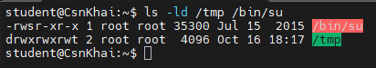

У каталогу /tmp наприкінці прав замість звичайної букви x стоїть літера t, що якраз вказує на активований Sticky біт.

У виконуваного файлу /bin/su на місці прав на виконання для власника стоїть літера s, що свідчить про увімкнений біт SetUID.

---

### 17) Які атрибути файлу повинні бути присутніми у командному скрипті?

Щоб операційна система дозволила запустити файл на виконання як програму або скрипт, у його правах доступу обов'язково має бути встановлений атрибут виконання хоча б для того користувача, який його запускає.

Якщо право на виконання відсутнє, то навіть за наявності прав на читання система видасть помилку доступу під час спроби запуску.

Окрім прав доступу у файловій системі, сам файл скрипта зазвичай повинен містити спеціальну послідовність символів на початку файлу наприклад: #!/bin/bash або #!/bin/sh, яка вказує ядру операційної системи, який саме інтерпретатор команд слід використовувати для виконання цього файлу.

---

### 18) Опишіть коротко роботу з механізмом квот, основні конфігураційні файли, принцип роботи, основні поняття.

Оскільки спочатку утиліта quota була відсутня в системі, я встановив її за допомогою пакетного менеджера:

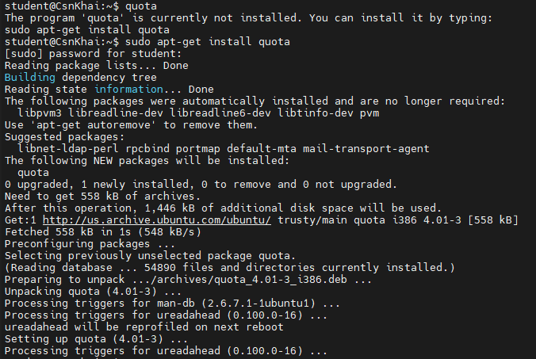

Після успішного завершення інсталяції я виконав саму команду для перевірки квот:

```
student@CsnKhai:~$ quota
student@CsnKhai:~$
```

Те, що команда нічого не вивела і одразу повернула новий рядок введення, означає, що для поточного облікового запису student на даній файловій системі дискові квоти наразі не налаштовані та не активовані.

Основні поняття та принцип роботи квот:

- Дискові квоти — це механізм обмеження дискового простору, доступного окремому користувачеві або групі, який запобігає можливості зайняти весь вільний простір на диску. Квотування налаштовується окремо для кожної файлової системи.
- Параметри обмеження: Квоти обмежують два ресурси
- Кількість блоків диска: обсяг даних у кілобайтах/мегабайтах.
- Число індексних дескрипторів: inode, тобто кількість файлів і каталогів, якими може володіти користувач.

М'які та жорсткі обмеження:

- М'яке обмеження: ліміт, який користувач може тимчасово перевищувати протягом заданого пільгового періоду часу. Після закінчення цього часу м'яке обмеження перетворюється на жорстке.
- Жорстке обмеження: абсолютна межа, перевищити яку система не дозволить у жодному разі.

Основні команди та конфігураційні файли:

- Редагування квот: Для зміни квот використовується команда edquota username, яка створює тимчасовий текстовий файл із налаштуваннями для редагування. Наприклад, для копіювання налаштувань від прототипу використовується ключ -p.
- Конфігураційні файли: Усі параметри квот зберігаються у спеціальних файлах у корені файлової системи — aquota.user для користувачів та aquota.group для груп.
- Додаткові утиліти: quotaon / quotaoff увімкнення та вимкнення квот, quotastats статистика використання.

---

### Висновки:

У ході виконання 2 лабораторної роботи було опановано базові навички роботи з командним рядком ОС Linux: навігацію файловою системою за допомогою відносних та абсолютних шляхів, керування файлами та каталогами, а також створення й аналіз жорстких і символьних посилань. Практично засвоєно використання основних системних утиліт (tree, ls, file, find, locate, grep, mount) для пошуку, фільтрації, поекранного перегляду інформації, роботи з файловими системами та визначення типів об'єктів і пристроїв у каталозі /dev. Це було дуже цікаво